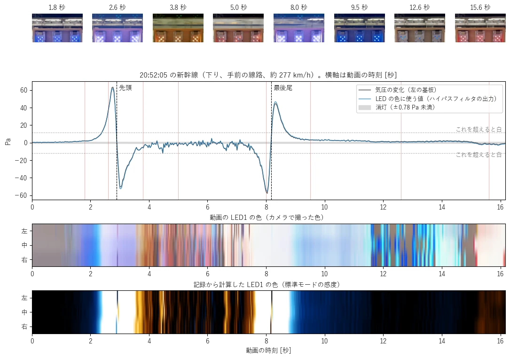
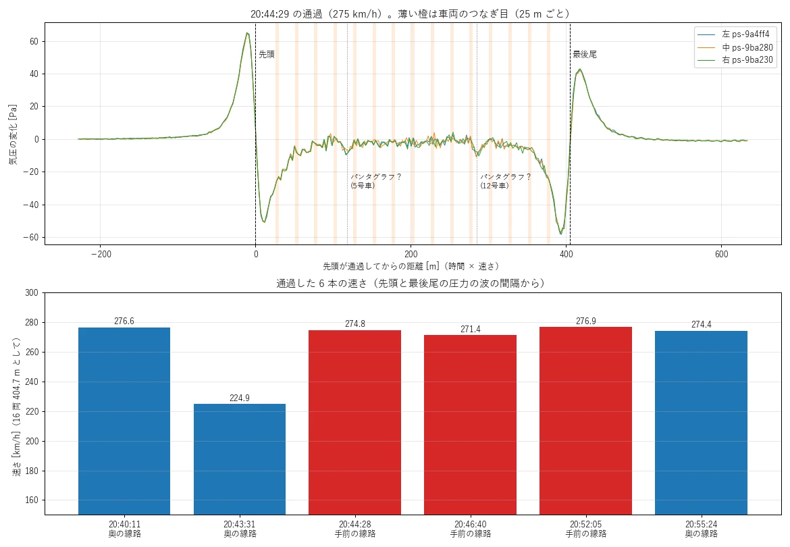
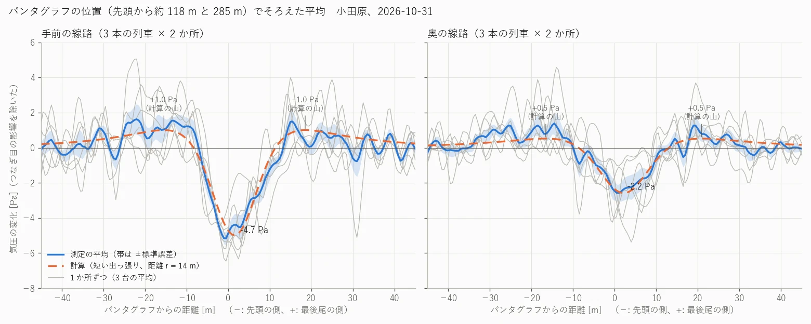
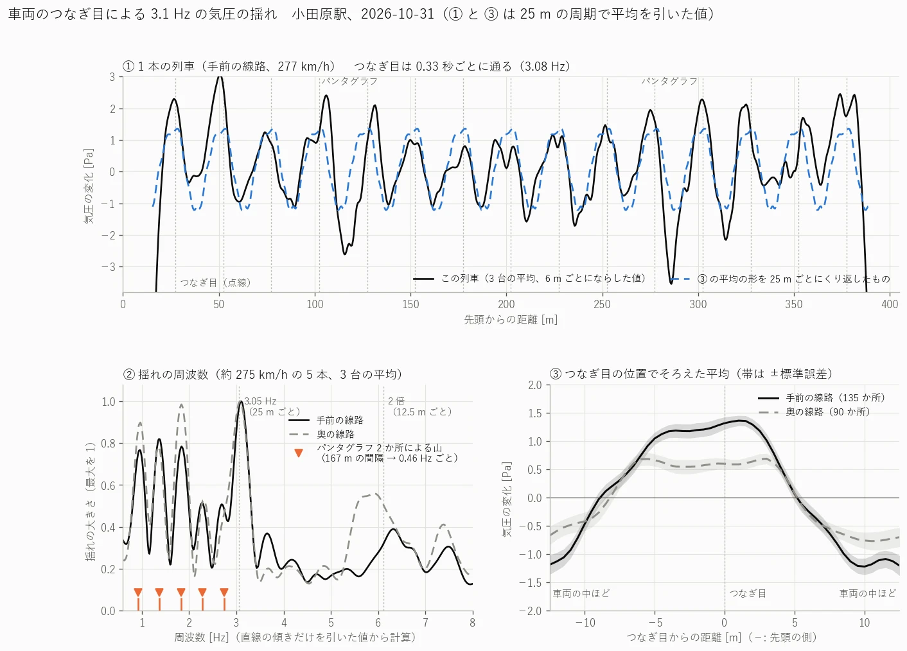

# ギャラリー

[esp32c3-bmp581 のページへ戻る](../)

この基板で、気圧の変化をとらえた例です。

<blockquote class="twitter-tweet" data-lang="ja" data-dnt="true">
気圧ゆらぎセンサで新幹線の通過速度を測ってみました。車両のつなぎ目やパンタグラフも気圧変化から見えている感じです。 <a href="https://t.co/lpvsGECZ19">pic.twitter.com/lpvsGECZ19</a>
&mdash; ミクミンP/Kazuhiro Sasao (@ksasao) <a href="https://x.com/ksasao/status/2116536953080545467?ref_src=twsrc%5Etfw">2026年10月31日</a></blockquote>

## 小田原駅での新幹線の通過（2026-10-31）

<video src="../../assets/images/esp32c3-bmp581/gallery/odawara-shinkansen.mp4" poster="../../assets/images/esp32c3-bmp581/gallery/odawara-shinkansen-poster.webp" muted loop playsinline preload="metadata"></video>
<button type="button" aria-label="動画を再生"></button>

小田原駅のホームで、3 台の基板を並べて置き、通過する新幹線を撮ったものです（20:52 の下り列車、約 277 km/h。音は消しています）。列車の先頭が近づくと気圧が上がって青から白に、先頭が通り過ぎると気圧が下がってオレンジに光ります。最後尾が通り過ぎるときは、気圧が下がってから上がるので、オレンジから白、青の順に光ります。

### 計測の条件

| 項目 | 内容 |
|---|---|
| 日時 | 2026-10-31 20:36〜20:56 |
| 場所 | 小田原駅のホーム。センサから手前の線路まで約 13 m、奥の線路まで約 17 m（推定） |
| 基板 | 3 台を並べて置き、それぞれの基板の中に、1/30 秒間隔で記録 |
| 通過した列車 | 6 本（手前の線路 3 本、奥の線路 3 本）、約 225〜277 km/h |

### LED の色と気圧の比較

動画の列車が通過したときの、気圧の変化（上）と、LED1 の色です。動画から読み取った色（中）と、記録から計算した色（下）が、よく合っています。

- 先頭が通過する直前に、約 +63 Pa（高さで約 5 m 下りたのと同じ変化）まで上がり、通過した直後に、約 −52 Pa まで下がります
- 最後尾では、逆に約 −57 Pa まで下がってから、約 +46 Pa まで上がります
- 先頭と最後尾の間の約 5 秒間は、元の気圧に近い値に戻っています

### 列車ごとの気圧の変化と速さ

上は、手前の線路を通過した列車の、3 台の基板の気圧の変化です。横軸は、時間に速さをかけて、先頭からの距離にしています。3 台の線は、ほとんど重なっています。

下は、通過した 6 本の列車の速さです。16 両編成の長さ（404.7 m）を、先頭の波と最後尾の波の時間の間隔で割って求めました。

### 気圧の模様のシミュレーション

<video src="../../assets/images/esp32c3-bmp581/gallery/odawara-topview.mp4" controls muted loop playsinline width="100%"></video>

列車のまわりの気圧の模様を、真上から見た計算です（0.5 倍速。空気の粘り気を考えない、単純な計算）。黄色の丸がセンサの位置で、下のグラフの黒い線が計測した値、青い線が計算した値です。列車の先頭の前は気圧が高く（赤）、先頭のすぐ後ろは低く（青）なります。この模様が列車と一緒に動いて、センサの前を通り過ぎます。

### パンタグラフと車両のつなぎ目による小さな変化

先頭から約 118 m と約 285 m の位置で、数 Pa の小さな気圧の低下があります。2 か所のパンタグラフの位置と合っています（手前の線路で約 −4.7 Pa）。

先頭と最後尾の間には、約 ±1 Pa の揺れが、0.33 秒ごと（約 3.1 Hz）に続いています。車両 1 両の長さ（25 m）ごとの揺れで、車両のつなぎ目によるものと考えられます。1 Pa は、高さ約 8.5 cm の差にあたる、ごく小さな変化です。

---

この記録は、基板の中への記録（[使い方](../#基板の中への記録)）で取ったものです。
