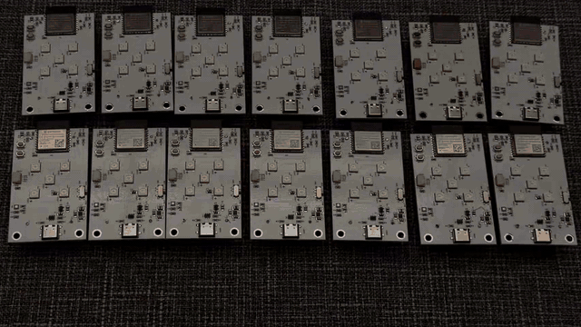
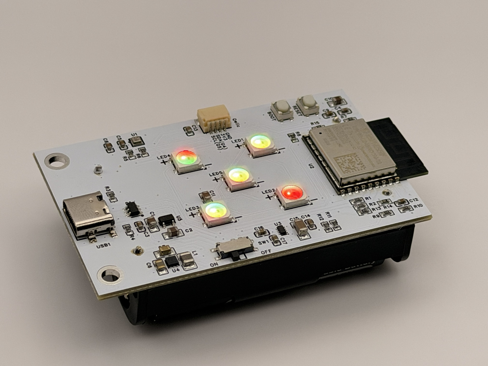
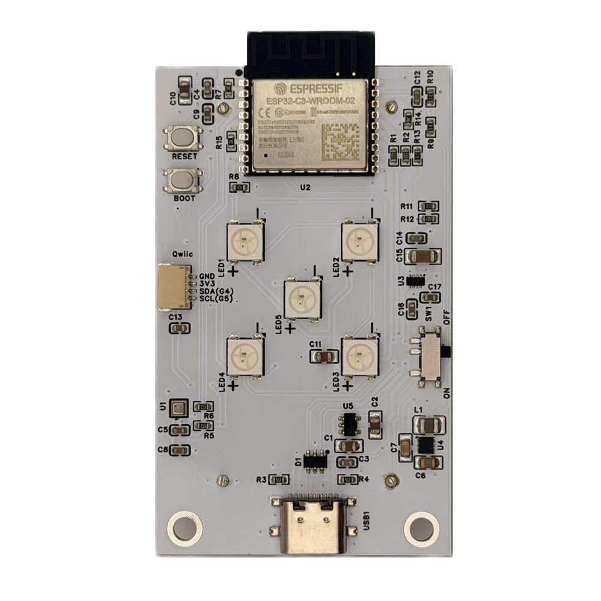
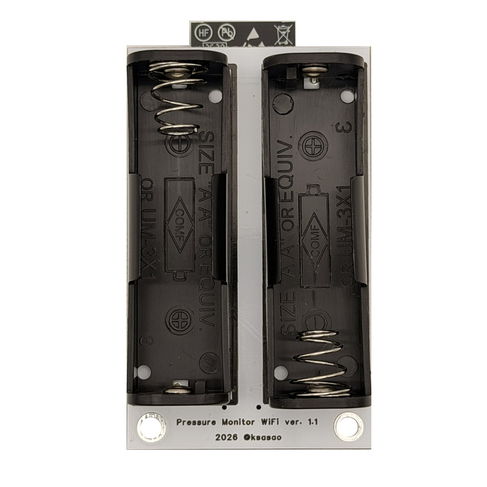
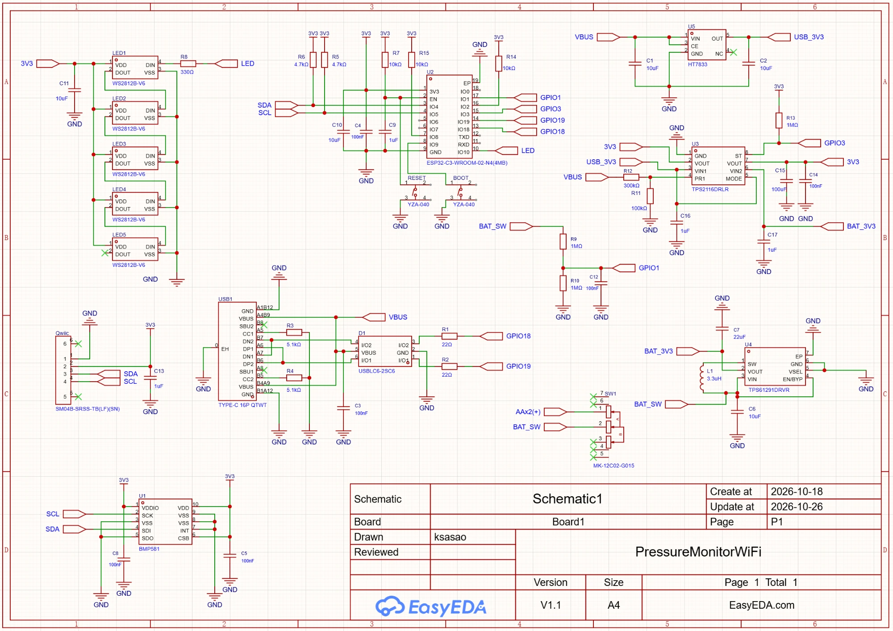

# BMP581搭載 ESP32-C3 気圧ゆらぎセンサ開発ボード

Bosch製の高精度気圧センサBMP581を搭載し、気圧の微小な変化を測定して、5個のRGB LEDの光としてリアルタイムに可視化するESP32-C3搭載ボードです。
単三電池ボックスを備えており、単三電池2本で単独動作できます。また、USB-C経由でプログラムを書き換えることができ、汎用のESP32-C3開発ボードとしても利用できます。
さらにQwiicコネクタを搭載しているため、ファームウェアを書き換えることでI²Cセンサなどを追加し、さまざまな環境センシング用途へ拡張できます。

よくあるご質問は、[こちら](faq/)にまとめています。

## 外観

左が表面、右が裏面（単三電池ボックス）です。

## 内容物

- 本体基板 × 1

単三電池と USB-C ケーブルは付属しません。別途ご用意ください。

## 仕様

| 項目 | 内容 |
|---|---|
| マイコン | ESP32-C3-WROOM-02-N4（Wi-Fi / Bluetooth LE、技適取得済みモジュール） |
| 気圧センサ | Bosch BMP581（I²C） |
| LED | フルカラー LED（WS2812B-V6）× 5 |
| 拡張コネクタ | Qwiic（I²C、3.3V） |
| 電源 | 単三電池 2本（電源スイッチ付き）、または USB-C。USB-C をつなぐと、自動で USB からの給電に切り替わる |
| 消費電流 | LED が消えているときに約 1mA |
| 記録 | 基板の中のフラッシュに記録できる。1/30 秒間隔で約 16 時間、1 秒間隔で約 68 時間、30 秒間隔で約 84 日 |
| 基板サイズ | 74 × 42 × 19 mm |

## ファームウェアの書き込み

パソコンの Chrome / Edge から、基板にファームウェアを書き込めます（Arduino IDE は不要です）。基板を USB-C でパソコンにつなぎ、書き込みツールを開いて、「接続」→「書き込み開始」を押すだけです。

**[書き込みツールを開く](flasher/)**

バージョンは、リリース日で表されます。最新のほか、以前のバージョンも選べます。通常は、明るさやモードなどの設定は、書き込み後も残ります。

## 回路図

2026-10-26 版（V1.1）。

### 回路の構成

| 部分 | 部品 | 内容 |
|---|---|---|
| マイコン | U2（ESP32-C3-WROOM-02-N4） | RESET ボタン（EN）と BOOT ボタン（IO9）。EN、IO2、IO8 を 10kΩ（R7、R14、R15）でプルアップ |
| 気圧センサ | U1（BMP581） | I2C、アドレス 0x46（SDO=GND）。SDA は IO4、SCL は IO5 |
| LED | LED1〜LED5（WS2812B-V6） | データは IO10 から R8 330Ω を通して LED1 へ。5 個がデイジーチェーン |
| USB | USB1（USB-C）、U5（HT7833）、D1（USBLC6-2SC6） | VBUS を 3.3V（USB_3V3）にする。D-/D+ は IO18/IO19（D1 で静電気から保護） |
| 電源スイッチ | SW1 | 電池（AA(+)x2）の入り切り。スイッチの後ろが BAT_SW |
| 電池 | U4（TPS61291）、単三 2 本 | BAT_SW を昇圧して 3.3V（BAT_3V3）にする |
| 電源の切り替え | U3（TPS2116） | USB があるときは USB_3V3、ないときは BAT_3V3 を、自動で選んで 3V3 にする（USB を優先）。VBUS を R12、R11 で分圧して PR1 に入れ、VBUS が約 4.0V を下回ると電池に切り替える |
| 電源の状態 | U3 の ST、R13 | どちらから給電しているかを IO3 へ（R13 1MΩ でプルアップ）。USB のときは High、電池のときは Low |
| 電池電圧 | R9、R10、C12 | BAT_SW（SW1 の後ろ）の電圧を 1/2 に分圧して IO1 へ（ADC で読める）。SW1 が OFF のときは、電池を切り離した状態の値になる |
| Qwiic | Qwiic コネクタ | I2C バス（3V3、SDA、SCL）に接続。他の I2C 機器をつなげる |

2026-10-05 版（V1.0）の基板では、SW1 が、3V3 を電池と USB のどちらから取るかを選ぶスイッチでした（U3 はありません）。V1.0 の回路図は[こちら](../assets/images/esp32c3-bmp581/schematic-v1.0.webp)です。

## ファームウェア

[firmware/esp32c3-bmp581](https://github.com/ksasao/pressure-monitor/tree/main/firmware/esp32c3-bmp581) に Arduino スケッチがあります。必要なライブラリ、ボード設定、調整できるパラメータは README を参照してください。

独自にプログラムを作りたい場合は、[firmware/esp32c3-bmp581-basic](https://github.com/ksasao/pressure-monitor/tree/main/firmware/esp32c3-bmp581-basic) に、気圧と温度、BOOT ボタン、LED、電池電圧、電源の状態（USB か電池か）の使い方をまとめた、短いサンプルがあります。

AI（Claude、ChatGPT など）に頼んで、ファームウェアを書き換えたい場合は、[AI でファームウェアを書き換える](vibe-coding/)をご覧ください。AI に渡す基板の情報（ピン割り当て、注意点など）も、そこにまとめています。

## 使い方

### 表示の見かた

| LED | 意味 |
|---|---|
| LED1 | 今の気圧の変化 |
| LED2〜LED5 | 1 フレームごとに前の LED1 の色が流れていく |

| 色 | 意味 |
|---|---|
| 青 | 気圧が上がった（センサを下げた） |
| オレンジ | 気圧が下がった（センサを持ち上げた） |
| 明るさ | 変化が大きいほど明るく、最大で白 |
| 消灯 | 変化がごくわずか |

気圧そのものではなく、ハイパスフィルタで取り出した「変化」を表示します。センサを動かさなければ、しばらくすると消灯します。

### 表示モード

BOOT ボタンを短く押して、4 種類のモードを切り替えます。

| 番号 | モード | 内容 |
|---|---|---|
| 1 | 標準（既定） | 気圧の変化を表示する。細かい動き向け |
| 2 | ドライブ | 気圧の変化を表示する。車や電車での移動（大きな高さの変化）向け。色の目盛りは対数で、歩くときの数 Pa の変化から、新幹線がトンネルを出入りするときの数百 Pa の変化（約 4〜400 Pa）まで、色の違いで見分けられる |
| 3 | カスタム | 気圧の変化を表示する。感度をスマホから変更できる |
| 4 | 固定色 | 全ての LED が、同じ色（HSV で自由に設定）で点灯する。気圧の変化に合わせて、明るさを変えることもできる |

LED の明るさの最大値は、1〜3 で共通の設定です。標準とドライブは、明るさの最大値だけを設定できます。

### ボタン

BOOT ボタンの短押しと長押しは、ボタンを離したときに動作します。

| 操作 | 動作 |
|---|---|
| 短押し | 今のモードの番号の数だけ、LED が 2 秒間、青く点灯する。その間に続けて押すと、次のモードに切り替わる（4 の次は 1） |
| 長押し（1.5 秒以上） | 設定モードと通常モードを切り替える |
| 20 秒押し続ける | 全ての LED が 1 秒間、赤く点滅したあと、設定を全て初期値に戻します。ボタンを離すと、再起動します |

たとえば、モード 2（ドライブ）のときに押すと、LED1 と LED2 が青く点灯します。2 秒以内にもう一度押すと、モード 3（カスタム）になり、LED1〜LED3 が青く点灯します。選んだモードは、電源を切っても残ります。

### 設定モード

長押しして離すと、基板が Wi-Fi のアクセスポイントになり、スマホで気圧の値とグラフを見たり、明るさ、カスタムモードの感度、固定色などの設定を変更したりできます。

1. 基板の BOOT ボタンを、LED が水色になるまで（1.5 秒以上）長押しして、離します
2. スマホの Wi-Fi で、SSID `pressure-monitor`（パスワードなし）に接続します
3. ブラウザで `http://192.168.4.1/` を開きます（QR コードを読み取ると便利です。Android では、「ネットワークへのログインが必要です」という通知が出ることがあります）。気圧の絶対値と変化量、グラフが表示されます。スマホを横向きにすると、グラフを広く表示します
4. 設定を変えるときは、右上の「⚙ 設定」を押します。値を変えると、LED にすぐ反映されます。気に入った設定は、「保存」を押して保存します（保存しないまま再起動すると、元の値に戻ります）
5. 「保存して終了」を押すと、Wi-Fi がオフになり、通常モードに戻ります

設定モードの間は、LED5 が状態表示になります（暗い水色は接続待ち、緑は接続中）。ページを閉じて（スマホの画面が消えて）から 10 分たつと、自動で通常モードに戻ります。変更できる項目や、詳しい使い方は、[firmware の README](https://github.com/ksasao/pressure-monitor/tree/main/firmware/esp32c3-bmp581#設定モードwi-fi)をご覧ください。

### 基板の中への記録

気圧の値を、基板の中（フラッシュ）に記録して、あとから CSV で保存できます。

1. 設定モードに入り、最初のページの「● 記録」を押します
2. 記録の間隔（1/30 秒、1 秒、30 秒）を選びます。1 秒と 30 秒は、その間の平均を記録します
3. 「Wi-Fi のまま記録する」か、「記録して Wi-Fi をオフにする（省電力）」を選びます。後者では、基板が通常モードに戻って、記録を続けます
4. 保存するときは、設定モードに入って、同じページの「CSV 保存」を押します。止めるときは「■ 停止」を押します

| 項目 | 内容 |
|---|---|
| 記録できる時間 | 1/30 秒で約 16 時間、1 秒で約 68 時間、30 秒で約 84 日。いっぱいになると、自動で止まります |
| 記録中の表示 | LED5 が、5 秒ごとに、短く赤く点滅します。いっぱいになると、黄色で 2 回点滅します |
| 電源が切れたとき | それまでの記録は残ります（1/30 秒の記録では、最後の 8 秒ほどが失われることがあります） |
| 次の記録 | 新しく記録を始めると、前の記録は消えます |

USB でパソコンにつないで、[`tools/serial-command.py`](https://github.com/ksasao/pressure-monitor/tree/main/tools) から、記録の開始・停止・保存をすることもできます。iPhone で保存するときの手順や、CSV の列の内容は、[firmware の README](https://github.com/ksasao/pressure-monitor/tree/main/firmware/esp32c3-bmp581#気圧の表示最初に開くページ)をご覧ください。

### 複数台の表示

設定モードで、役割を「送信」と「ハブ」に設定すると、複数台の気圧を、ESP-NOW で 1 台のハブに集めて、スマホのブラウザで並べて表示し、記録できます。アプリのインストールは不要です。

送信とハブは、無線を使い続けるため、省電力の待機（ライトスリープ）に入らず、電池の持ちが短くなります。ハブは、USB からの給電をおすすめします。使い方は、[firmware の README](https://github.com/ksasao/pressure-monitor/tree/main/firmware/esp32c3-bmp581#複数台の表示esp-now)をご覧ください。

### 音（Modulino Buzzer）

Qwiic コネクタに [Arduino Modulino Buzzer](https://docs.arduino.cc/hardware/modulino-buzzer/)（ABX00108、別売）をつなぐと、LED1 の色に合わせて、音のフレーズを鳴らします。気圧が上がるときは明るい響き、下がるときは暗い響きで、変化が大きく、長く続くほど、にぎやかになります。音色と音の高さは、設定モードで選べます。つながっていなければ、何もしません。

### 電源

単三電池 2 本、または USB-C から給電できます。

| 使い方 | 操作 |
|---|---|
| 電池で使う | SW1 を ON にします |
| USB-C で使う | USB-C をつなぐと、SW1 の位置にかかわらず、自動で USB から給電します。電池を入れていないときや、USB だけで長く使うときは、SW1 を OFF にしてください |
| 電池で動かしながら USB-C をつなぐ（SW1 が ON） | USB に切り替わります。USB を抜くと、自動で電池に戻ります |

SW1 が ON のままだと、USB で動いている間も、昇圧回路（U4）が動いているため、電池をわずかに消費します。

**USB-C にモバイルバッテリーをつなぐ場合は、「低電流モード」（微弱電流モード、IoT モードなどの名称）に対応した製品を推奨します。** モバイルバッテリーの多くは、出力電流が小さい状態が続くと、負荷がつながっていないとみなして、出力を止めます。本機は、LED が消えているとき、省電力のために電流が約 1mA まで下がるので、低電流モードに対応していない製品では、数分で給電が止まることがあります。

## 制約

- 電池と USB のどちらで動いているかは、IO3（U3 の ST）で判別できます。ただし、今のファームウェアは、この信号を使っていません（V1.0 の基板では、回路の構成上、判別できません）。
- 電池電圧は IO1 で読むことができます。ファームウェアは、1 分に 1 回測り、CSV の最後の列（`battery_mV`）に出力します。SW1 が OFF のときは、電池が入っていても、数百 mV の小さな値になります（実測で約 0.3V）。
- BMP581 は温度補正済みの気圧を出力します。起動直後は、センサの自己発熱で温度が上がり続けますが、ハイパスフィルタがゆっくりした変化を除くので、表示への影響は小さいです。

## お問い合わせ

商品の内容や使い方のご質問、製造に起因する欠品・破損（初期不良）は、[お問い合わせフォーム](https://forms.gle/qyRgTUC6YQnALjNT8)からご連絡ください。

ご注文、お支払い、配送中の破損については、ご購入先のショップにお問い合わせください。

独自に書き換えたファームウェア（AI に書いてもらったものを含みます）の動作は、サポートの対象外です。元のファームウェアに戻しても起きる不具合は、お問い合わせください。
